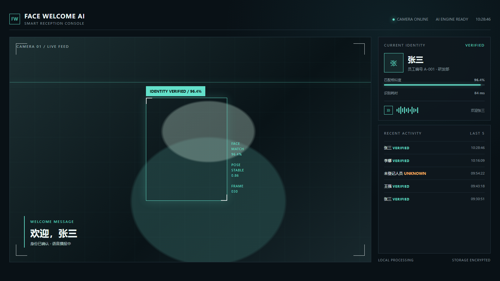
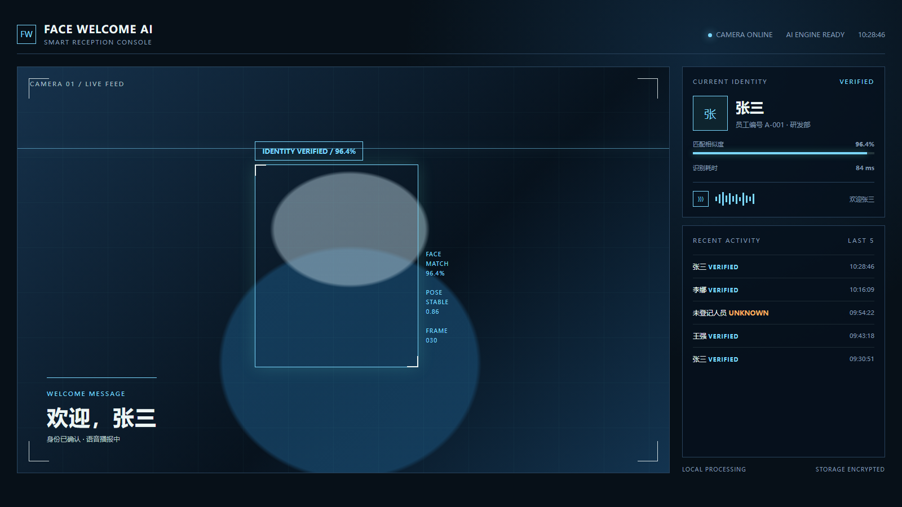
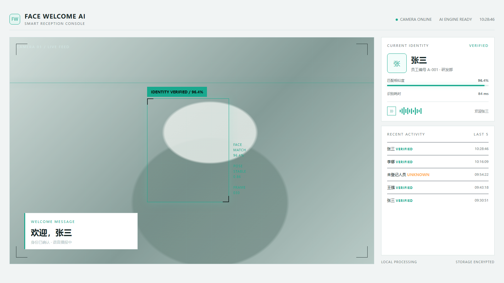

# 样式参考图

## 方案一：深色 AI 中控台

- 关键词：专业、稳定、信息密度高。
- 适合：长期运行、前台、办公室和内部使用。
- 优点：识别状态、匹配分数、播报和历史记录都很清楚。
- 风险：更像监控/控制台，迎宾氛围相对克制。

## 方案二：轻量 HUD 迎宾界面

- 关键词：科技、展示感、未来感。
- 适合：展厅、活动、接待大屏和演示。
- 优点：视觉识别度高，欢迎反馈更有仪式感。
- 风险：长时间使用可能显得信息偏少；需要控制动效和装饰量。

## 方案三：企业级智能迎宾终端

- 关键词：明亮、正式、易用。
- 适合：公司前台、会议室、访客登记和日常办公环境。
- 优点：可读性好，容易让非技术用户理解。
- 风险：科技感较弱，需要通过动效和识别状态细节增强产品气质。

## 初步建议

首版建议以“方案一”为基础，吸收“方案二”的识别框和欢迎动画。这样既保留专业软件的可信度，又能让“欢迎 xxx”成为明显的产品体验。

## 生成说明

这些是程序界面的高保真样式稿，不是最终摄像头实拍效果。当前摄像头画面使用抽象人形占位，后续接入真实摄像头后，需要继续验证人脸框位置、文字对比度、长姓名和多人同时出现时的布局。
